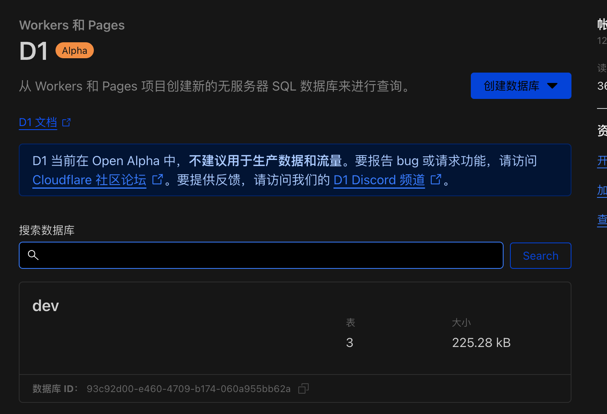

# Initialize/Update D1 Database

When executing the wrangler login command for the first time, you will be prompted to log in. Follow the prompts to complete the login process.

## Initialize Database

```bash
cd worker
cp wrangler.toml.template wrangler.toml
# Create D1 and execute schema.sql
wrangler d1 create temp-email-db
wrangler d1 execute temp-email-db --file=../db/schema.sql --remote
```

> [!tip]
> Use a D1 database name such as `temp-email-db` or `cloudflare-temp-email-prod`.

After creation, you can see the D1 database in the Cloudflare console.



## Update Database Schema

For `schema` updates, please confirm your previously deployed version.
Check the [Changelog](https://github.com/dreamhunter2333/cloudflare_temp_email/blob/main/CHANGELOG.md)

Find the `patch` file you need to execute and run it, for example:

```bash
cd worker
wrangler d1 execute temp-email-db --file=../db/2024-01-13-patch.sql --remote
wrangler d1 execute temp-email-db --file=../db/2024-04-03-patch.sql --remote
```

### v0.0.10: Mail cleanup indexes

After upgrading the Worker, run the schema migration from the Admin database page to create these two indexes. No new columns or mail ingestion configuration changes are required:

- `idx_raw_mails_cleanup_unknown`: covers `(created_at, id, address)` to reduce table lookups during unknown-mail cleanup.
- `idx_raw_mails_source_domain_created_at`: indexes the domain extraction expression, `created_at`, and `id`. Custom cleanup SQL using `lower(trim(substr(source, instr(source, '@') + 1), ' <>'))` can use it to filter domains; global time ordering across multiple domains may still require an additional sort.

The manual SQL migration is `db/2026-11-06-cleanup-indexes.sql` and is safe to rerun. Both `db/schema.sql` and Admin initialization also include these indexes for new databases.

Indexes consume storage and add write overhead. Building them scans existing data, so schedule the migration outside busy periods. They are created only during database initialization or migration, not automatically on Worker startup or deployment.

To remove these indexes without deleting existing mail data, run:

```sql
DROP INDEX IF EXISTS idx_raw_mails_cleanup_unknown;
DROP INDEX IF EXISTS idx_raw_mails_source_domain_created_at;
```

Dropping indexes does not roll back the database version. To restore them, rerun the SQL migration file above.
