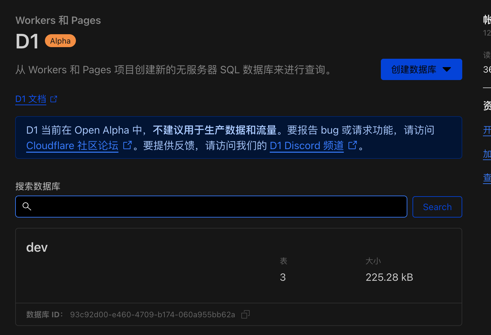

# 初始化/更新 D1 数据库

第一次执行登录 wrangler 命令时，会提示登录, 按提示操作即可

## 初始化数据库

```bash
cd worker
cp wrangler.toml.template wrangler.toml
# 创建 D1 并执行 schema.sql
wrangler d1 create temp-email-db
wrangler d1 execute temp-email-db --file=../db/schema.sql --remote
```

> [!tip] 命名建议
> 数据库名称请使用例如 `temp-email-db`、`cloudflare-temp-email-prod` 这样的名称。

创建完成后，我们在 cloudflare 的控制台可以看到 D1 数据库



## 更新数据库 schema

`schema` 更新，请确认你之前部署的版本,
查看 [更新日志](https://github.com/dreamhunter2333/cloudflare_temp_email/blob/main/CHANGELOG.md)

找到需要执行的 `patch` 文件, 执行, 例如:

```bash
cd worker
wrangler d1 execute temp-email-db --file=../db/2024-01-13-patch.sql --remote
wrangler d1 execute temp-email-db --file=../db/2024-04-03-patch.sql --remote
```

### v0.0.10：邮件清理索引

升级 Worker 后，在管理后台的数据库页面执行 Schema 迁移，可创建以下两个索引，无需新增字段或修改收信配置：

- `idx_raw_mails_cleanup_unknown`：覆盖 `(created_at, id, address)`，减少未知地址邮件清理时的回表读取。
- `idx_raw_mails_source_domain_created_at`：覆盖域名提取表达式、`created_at` 和 `id`。自定义清理 SQL 使用 `lower(trim(substr(source, instr(source, '@') + 1), ' <>'))` 时，可利用此索引筛选域名；多个域名的全局时间排序仍可能需要额外排序。

手动 SQL 迁移文件为 `db/2026-11-06-cleanup-indexes.sql`，可重复执行。新建数据库的 `db/schema.sql` 和管理后台初始化也包含这两个索引。

索引占用存储并增加写入成本。创建索引需要扫描已有数据，建议避开繁忙时段执行。索引不会在 Worker 启动或部署时自动创建，只有初始化或执行数据库迁移时才会创建。

如需撤销这两个索引，可手动执行以下 SQL，已有邮件数据不会被删除：

```sql
DROP INDEX IF EXISTS idx_raw_mails_cleanup_unknown;
DROP INDEX IF EXISTS idx_raw_mails_source_domain_created_at;
```

删除索引不会回退数据库版本；如需恢复，可重新执行上述 SQL 迁移文件。
